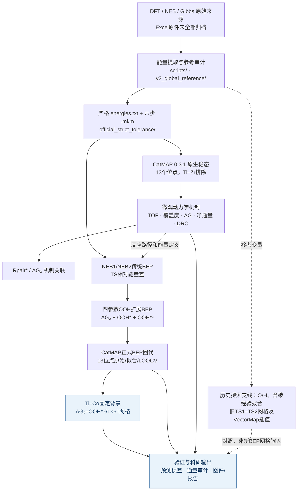

# 1-己烯环氧化 CatMAP 项目：科研逻辑架构与输入—输出路径总览

> **范围**：GitHub `ly5681672-max/catmap` / `catmap_code_collection_20261013`，基线版本 `9732f483524e`，盘点日期 2026-10-15。  
> **本地对应根目录**：`H:\\catmap\\catmap\\catmap_code_collection_20261013\\`。  
> **阅读原则**：研究目标优先；正式CatMAP与经验统计分开；保留原数据；绝对/有效反应能、NEB有符号TS差及CatMAP有效势垒分开。本文是导航与文件流说明，**没有重新执行DFT或全部历史计算脚本**。

## 一、全项目只看一张图



**一句话主线：** 原始能量与六步机理 → 严格CatMAP稳态 → TOF/覆盖度/DRC解释 → BEP修正TS1 → 13位点预测检验 → ΔG₂–OOH*条件活性网格 → 可靠性审计。**这些环节有依赖关系，但不是每个旧专题结果都直接成为新网格输入。**

### 反应网络和能量变量（避免混淆）

```text
气相 C6H12 + H2O2 + *
    │ ΔG1：反应物共吸附
    ▼
  Rpair*
    │ ΔG2：经 TS1* 的氧转移
    ▼
  EpoxideHHO*
    │ ΔG3：环氧己烷释放
    ▼
  HHO* + C6H12O(g)
    │ ΔG4：经 TS2* 的后续表面转化
    ▼
  OHHa*
    │ ΔG5：表面水形成
    ▼
  H2O*
    │ ΔG6：水脱附
    ▼
  H2O(g) + *
```

定义：`ΔG₂ = G(EpoxideHHO*)−G(Rpair*)`；`Y₁ = G(TS1*)−G(Rpair*)` 为**有符号能量差**，不自动等同非负活化能。`ΔG₃ = G(HHO*)+μ(C6H12O_g)−G(EpoxideHHO*)` 为产物释放能量差；引用时区分标准形成能与有效储库化学势。六步中第2、4步含显式NEB TS；第1、3、5、6步在当前模型中采用CatMAP端点势垒近似。

---

## 二、实际输入 → 脚本 → 输出：十段完整路径

以下所有路径均**相对本项目根目录**；拼接上述H盘根目录即为完整Windows本地地址。每一条路径已按本次GitHub树核对存在。表中“脚本”是主要入口，部分专题曾从其他归档脚本/缓存提取中间数据，具体以各专题报告为准。

| 环节 | 输入（真实路径） | 核心脚本 | 输出（真实路径） | 说明/性质 |
|---|---|---|---|---|
| **A. 原始输入与来源核查** | [energies.txt](catmap_official_run/energies.txt)<br>[alkene_epoxidation.mkm](catmap_official_run/alkene_epoxidation.mkm) | [extract_neb_gibbs.py](scripts/extract_neb_gibbs.py) | [build_phase1_tables.py](scripts/build_phase1_tables.py)<br>[audit_slab_references.py](v2_global_reference/scripts/audit_slab_references.py) | 早期Excel/DFT/NEB提取与参考审计；外部原始Excel**未打包**。根目录.mkm主要用于静态校验，不是正式稳态入口。 |
| **B. CatMAP严格基准（13/14）** | [energies.txt](catmap_official_run/results/official_strict_tolerance/ti/energies.txt)<br>[alkene_epoxidation.mkm](catmap_official_run/results/official_strict_tolerance/ti/alkene_epoxidation.mkm) | [run_catmap_official.py](catmap_official_run/results/official_strict_tolerance/ti/run_catmap_official.py) | [convergence_13sites.csv](analyses/microkinetic_mechanism_13sites/data/convergence_13sites.csv)<br>[gas_turnover_frequencies_13sites.csv](analyses/microkinetic_mechanism_13sites/data/gas_turnover_frequencies_13sites.csv) | <surface>替换成ti、tico、tife等；14套配置归档，13位点已验证；Ti–Zr未纳入正式13点。CatMAP 0.3.1，333.15 K。 |
| **C. 稳态与反应网络机制** | [convergence_13sites.csv](analyses/microkinetic_mechanism_13sites/data/convergence_13sites.csv)<br>[activity_analysis_data.csv](catmap_official_run/results/activity_analysis_round1/activity_analysis_data.csv) | [analyze_mechanism_outputs.py](analyses/microkinetic_mechanism_13sites/scripts/analyze_mechanism_outputs.py) | [coverage_13sites.csv](analyses/microkinetic_mechanism_13sites/data/coverage_13sites.csv)<br>[rate_control_matrix.csv](analyses/microkinetic_mechanism_13sites/data/rate_control_matrix.csv)<br>[reaction_energy_13sites.csv](analyses/microkinetic_mechanism_13sites/data/reaction_energy_13sites.csv)<br>[effective_barriers_13sites.csv](analyses/microkinetic_mechanism_13sites/data/effective_barriers_13sites.csv)<br>[TOF_flux_consistency.csv](analyses/microkinetic_mechanism_13sites/data/TOF_flux_consistency.csv) | 输出覆盖度、TOF、六步净通量、有效势垒、官方DRC。专用脚本可补充缺失DRC；不能将DRC直接等同唯一RDS。 |
| **D. ΔG₃—TOF关联** | [reaction_energy_13sites.csv](analyses/microkinetic_mechanism_13sites/data/reaction_energy_13sites.csv)<br>[coverage_13sites.csv](analyses/microkinetic_mechanism_13sites/data/coverage_13sites.csv)<br>[rate_control_matrix.csv](analyses/microkinetic_mechanism_13sites/data/rate_control_matrix.csv) | [build_mechanism_package.py](analyses/dG3_coverage_DRC_mechanism/scripts/build_mechanism_package.py) | [combined_dG3_coverage_DRC_TOF.csv](analyses/dG3_coverage_DRC_mechanism/data/combined_dG3_coverage_DRC_TOF.csv)<br>[dG3_coverage_TOF_correlations.csv](analyses/dG3_coverage_DRC_mechanism/data/dG3_coverage_TOF_correlations.csv)<br>[dG3_coverage_TOF_joint.png](analyses/dG3_coverage_DRC_mechanism/figures/dG3_coverage_TOF_joint.png) | 解释环氧产物释放热力学与覆盖度/DRC/TOF关联；第3步端点势垒与关系存在模型耦合。 |
| **E. Rpair*关联与条件敏感性** | [coverage_13sites.csv](analyses/microkinetic_mechanism_13sites/data/coverage_13sites.csv)<br>[rate_control_matrix.csv](analyses/microkinetic_mechanism_13sites/data/rate_control_matrix.csv)<br>[combined_dG3_coverage_DRC_TOF.csv](analyses/dG3_coverage_DRC_mechanism/data/combined_dG3_coverage_DRC_TOF.csv) | [run_rpair_sensitivity.py](analyses/Rpair_coverage_TOF_mechanism/scripts/run_rpair_sensitivity.py) | [rpair_13sites_joined.csv](analyses/Rpair_coverage_TOF_mechanism/data/rpair_13sites_joined.csv)<br>[scan_rows.csv](analyses/Rpair_coverage_TOF_mechanism/results/scan_rows.csv)<br>[energy_sensitivity.csv](analyses/Rpair_coverage_TOF_mechanism/results/energy_sensitivity.csv) | 先用归档数据画Rpair*覆盖度—TOF；后针对Ti/Ti–Co/Ti–Fe实际运行能量和浓度扰动；README里“尚未运行”已滞后于results。 |
| **F. 传统BEP与NEB能量重建** | [source_carbon_O_H_TS1.csv](analyses/BEP_energy_correction_optimization/data/source_carbon_O_H_TS1.csv)<br>[reaction_energy_13sites.csv](analyses/microkinetic_mechanism_13sites/data/reaction_energy_13sites.csv) | [analyze_bep_reconstruction.py](analyses/BEP_scaling_and_TS_reconstruction/scripts/analyze_bep_reconstruction.py) | [BEP_extended_model_ranking.csv](analyses/BEP_scaling_and_TS_reconstruction/origin_exports/BEP_extended_model_ranking.csv)<br>[BEP_TS1_TS2_reconstruction.csv](analyses/BEP_scaling_and_TS_reconstruction/origin_exports/BEP_TS1_TS2_reconstruction.csv)<br>[01_traditional_BEP.png](analyses/BEP_energy_correction_optimization/figures/01_traditional_BEP.png) | NEB1 ΔG₂→TS1−Rpair、NEB2 ΔG₄→TS2−HHO；传统线性BEP的NEB1样本内R²≈0.205。 |
| **G. 扩展BEP与OOH*二次项** | [source_carbon_O_H_TS1.csv](analyses/BEP_energy_correction_optimization/data/source_carbon_O_H_TS1.csv)<br>[BEP_extended_model_ranking.csv](analyses/BEP_scaling_and_TS_reconstruction/origin_exports/BEP_extended_model_ranking.csv) | [plot_ooh_quadratic_bep.py](analyses/BEP_energy_correction_optimization/scripts/plot_ooh_quadratic_bep.py) | [08_OOH_quadratic_BEP_predictions.csv](analyses/BEP_energy_correction_optimization/data/08_OOH_quadratic_BEP_predictions.csv)<br>[08_OOH_quadratic_BEP_fit.svg](analyses/BEP_energy_correction_optimization/figures/08_OOH_quadratic_BEP_fit.svg)<br>[OOH_QUADRATIC_BEP_FIT_NOTE.md](analyses/BEP_energy_correction_optimization/reports/OOH_QUADRATIC_BEP_FIT_NOTE.md) | 4参数：ΔG₂＋OOH*＋OOH*²；样本内R²≈0.8867，OOH*为**历史单吸附态**，只作候选代理。 |
| **H. 13位点BEP→CatMAP正式重算** | [source_carbon_O_H_TS1.csv](analyses/BEP_OOH_activity_map/catmap_official_run/inputs/snapshots/source_carbon_O_H_TS1.csv)<br>[energies.txt](analyses/BEP_OOH_activity_map/catmap_official_run/inputs/snapshots/tico/energies.txt) | [run_bep_ooh_activity_map.py](analyses/BEP_OOH_activity_map/catmap_official_run/scripts/run_bep_ooh_activity_map.py) | [baseline_validation.csv](analyses/BEP_OOH_activity_map/catmap_official_run/data/baseline_validation.csv)<br>[exact_BEP_fit.json](analyses/BEP_OOH_activity_map/catmap_official_run/data/exact_BEP_fit.json)<br>[13site_original_TOF.csv](analyses/BEP_OOH_activity_map/catmap_official_run/data/13site_original_TOF.csv)<br>[13site_BEP_fitted_TOF.csv](analyses/BEP_OOH_activity_map/catmap_official_run/data/13site_BEP_fitted_TOF.csv)<br>[13site_BEP_LOOCV_TOF.csv](analyses/BEP_OOH_activity_map/catmap_official_run/data/13site_BEP_LOOCV_TOF.csv) | CatMAP 0.3.1原生重新求稳态；原始、样本内BEP、逐位点留一重拟合三组，不等同独立实验验证。 |
| **I. 新BEP约束二维官方网格** | [exact_BEP_fit.json](analyses/BEP_OOH_activity_map/catmap_official_run/data/exact_BEP_fit.json)<br>[alkene_epoxidation.mkm](analyses/BEP_OOH_activity_map/catmap_official_run/inputs/snapshots/tico/alkene_epoxidation.mkm) | [run_bep_ooh_activity_map.py](analyses/BEP_OOH_activity_map/catmap_official_run/scripts/run_bep_ooh_activity_map.py) | [grid_5x5.csv](analyses/BEP_OOH_activity_map/catmap_official_run/data/grid_5x5.csv)<br>[grid_15x15.csv](analyses/BEP_OOH_activity_map/catmap_official_run/data/grid_15x15.csv)<br>[grid_61x61.csv](analyses/BEP_OOH_activity_map/catmap_official_run/data/grid_61x61.csv)<br>[03_CatMAP_BEP_OOH_dG2_activity_61x61.png](analyses/BEP_OOH_activity_map/catmap_official_run/figures/03_CatMAP_BEP_OOH_dG2_activity_61x61.png) | ΔG₂–历史OOH* 61×61=3721节点；以Ti–Co其余能量固定为条件背景。并非所有位点共有背景的普适火山。 |
| **J. 新BEP预测与数值验收** | [13site_BEP_LOOCV_TOF.csv](analyses/BEP_OOH_activity_map/catmap_official_run/data/13site_BEP_LOOCV_TOF.csv)<br>[grid_61x61.csv](analyses/BEP_OOH_activity_map/catmap_official_run/data/grid_61x61.csv)<br>[grid_61x61_net_rates.csv](analyses/BEP_OOH_activity_map/catmap_official_run/data/grid_61x61_net_rates.csv) | [audit_grid_flux.py](analyses/BEP_OOH_activity_map/catmap_official_run/scripts/audit_grid_flux.py) | [flux_audit_summary_20261015.json](analyses/BEP_OOH_activity_map/catmap_official_run/data/flux_audit_summary_20261015.json)<br>[NET_FLUX_AUDIT_20261015.md](analyses/BEP_OOH_activity_map/catmap_official_run/reports/NET_FLUX_AUDIT_20261015.md)<br>[FINAL_BEP_OOH_ACTIVITY_MAP_REPORT.md](analyses/BEP_OOH_activity_map/catmap_official_run/reports/FINAL_BEP_OOH_ACTIVITY_MAP_REPORT.md) | 输入哈希、基线一致性、LOOCV、网格状态与通量。极低TOF节点有相对净通量精度警示；不为此大规模重跑。 |

### 2.1 官方严格基线的路径模板（容易找错）

```text
catmap_official_run/
├── energies.txt                         # 总能量快照，不等于所有13点新跑的输出
├── alkene_epoxidation.mkm               # 根目录静态校验配置，不是正式稳态入口
├── run_catmap.py                        # parse/verify为主，不能视为已经run稳态
└── results/
    ├── official_strict_tolerance/
    │   ├── ti/
    │   │   ├── energies.txt
    │   │   ├── alkene_epoxidation.mkm
    │   │   └── run_catmap_official.py
    │   ├── tico/                        # 例如Ti–Co
    │   ├── tife/                        # 例如Ti–Fe
    │   ├── ...                          # 其余严格位点
    │   └── tizr/                        # 归档存在，但当前13点统计中未验证/排除
    ├── activity_analysis_round1/         # 早期后处理、TOF及ΔG₃图片
    ├── official_14/                      # 第一轮14位点历史副本
    └── official_14_retry_damping50/      # 历史数值重试档案
```

主要储库输入为：**333.15 K**，`H2O2_g=0.185`、`C6H12_g=1`、`H2O_g=0.815`、`C6H12O_g=1e-20`（现有`.mkm`中为有效浓度输入，不能未经确认改称bar或mol/L），单有效中心。**14个严格位点目录中13个形成稳定数据集，Ti–Zr没有列入。**

### 2.2 最新OOH-BEP官方计算：最重要的一条输入输出链

```text
analyses/BEP_energy_correction_optimization/data/source_carbon_O_H_TS1.csv
    → ΔG₂ + E(OOH*) + E(OOH*)² 的13点拟合 / LOOCV
    → analyses/BEP_OOH_activity_map/catmap_official_run/data/exact_BEP_fit.json
    → inputs/snapshots/<surface>/energies.txt + alkene_epoxidation.mkm
    → 【新BEP预测TS1，再加回G(Rpair*)】
    → scripts/run_bep_ooh_activity_map.py
         ├─ baseline_validation.csv
         ├─ 13site_original_TOF.csv
         ├─ 13site_BEP_fitted_TOF.csv
         ├─ 13site_BEP_LOOCV_TOF.csv
         ├─ BEP_TS1_predictions_and_LOOCV.csv
         └─ Ti–Co条件网格 5×5 → 15×15 → 61×61
                  ├─ grid_61x61.csv
                  ├─ grid_61x61_coverages.csv
                  ├─ grid_61x61_net_rates.csv
                  └─ figures/03_CatMAP_BEP_OOH_dG2_activity_61x61.png
```

上面`inputs/snapshots/`、`scripts/`、`data/`、`figures/`等从`analyses/BEP_OOH_activity_map/catmap_official_run/`起算。这里全部是相对层级，不是根目录同名文件；最容易混用的是**上级分析包的旧独立解析响应面**与**子目录的CatMAP 0.3.1正式网格**。

四参数示意（eV）：
```text
u = ΔG₂ + 2.0922766923
z = E(OOH*) + 4.3098743846
Y₁ ≈ 0.412123 + 0.370377*u + 0.200217*z − 0.309777*z²
```

精确拟合系数应从 [exact_BEP_fit.json](analyses/BEP_OOH_activity_map/catmap_official_run/data/exact_BEP_fit.json)读取，避免使用截断小数覆盖原始输入。**OOH*是历史单吸附态形成能，仅作为BEP外部特征，不是六步反应网络中的另一个独立OOH吸附态。**

**当前报告口径：** 13/13原始基线、13/13样本内BEP、13/13留一BEP均有正式CatMAP结果；61×61共3721节点记录为成功，其中25节点为与5×5阶段输入SHA完全一致的CatMAP计算缓存复用。该网格固定Ti–Co除EpoxideHHO/TS1之外的反应态能量。高活性峰值位于边界，不能称已找到内部火山最优。BEP样本内R²≈0.8867，但Ti–Co的留一预测TOF明显失稳，**不能将样本内排名反转表述为双核优势被证明**。

---

## 三、其余专题怎么归类：正式主线之外的参考支线

| 专题/目录 | 入口地址 | 与现有主线关系 |
|---|---|---|
| V1串行机理历史模型 | [ti_re_serial_neb.mkm](models/v1_serial/ti_re_serial_neb.mkm) | 历史结构/计量/能量映射验证；**不属于当前六步严格基线**。 |
| V2全局能量参考审计 | [construct_global_gibbs.py](v2_global_reference/scripts/construct_global_gibbs.py) | Slab、NEB源行、热力学网络及参考能一致性审计；不得绕过验证直接替代strict输入。 |
| 旧TS1–TS2官方活性图 | [catmap_TS1_TS2_activity_grid_50x50.png](analyses/TS1_TS2_descriptor_volcano/figures/catmap_official/catmap_TS1_TS2_activity_grid_50x50.png) | 旧TS1/TS2描述符：50×50实算；独立于新OOH二次BEP分支。 |
| 旧TS1–TS2高分辨率插值 | [catmap_VectorMap_400x400_from_grid_50x50.png](analyses/TS1_TS2_descriptor_volcano/figures/catmap_official/catmap_VectorMap_400x400_from_grid_50x50.png) | 400×400是VectorMap插值显示，**不是160000次CatMAP实算**。 |
| 历史O/H—TOF经验回归 | [analyze_legacy_descriptors.py](analyses/empirical_O_H_descriptor_analysis/scripts/analyze_legacy_descriptors.py) | 经验模型与200/400网格，无新的CatMAP稳态。 |
| O/H→TS1/TS2→TOF映射 | [analyze_oh_to_ts_to_tof.py](analyses/O_H_to_TS1_TS2_to_TOF/scripts/analyze_oh_to_ts_to_tof.py) | 旧描述符经统计映射TS，查询历史CatMAP插值背景；不是新动力学求解。 |
| 独立C*来源与O/H→TS1 | [CSTAR_SOURCE_AUDIT.md](analyses/C_O_H_to_TS1_scaling/reports/CSTAR_SOURCE_AUDIT.md) | 无可追溯独立C*时不能用C6H12*代替。 |
| 含碳物种→TS1候选描述符 | [matched_carbon_O_H_TS1_data.csv](analyses/Carbon_containing_descriptor_to_TS1/data/matched_carbon_O_H_TS1_data.csv) | 旧含碳吸附态与O/H组合的统计特征探索；注意参考差异。 |
| OOH–ΔG₂独立解析条件面 | [01_BEP_OOH_dG2_TiCo_conditional_activity.svg](analyses/BEP_OOH_activity_map/figures/01_BEP_OOH_dG2_TiCo_conditional_activity.svg) | 早期独立解析求解，不要冒充正式61×61 CatMAP官方网格。 |
| 回归测试 | [test_catmap_031_energy_semantics.py](tests/test_catmap_031_energy_semantics.py) | 数值语义/映射的代码测试，不代替独立DFT或实验验证。 |
| 汇报图件处理 | [revise_presentation.py](presentation_revision_20261013/revise_presentation.py) | 仅PPT编辑，**不参与**化学计算。 |

本次扫描确认 `analyses/` 下有 **11个专题目录**：`BEP_OOH_activity_map`、`BEP_energy_correction_optimization`、`BEP_scaling_and_TS_reconstruction`、`C_O_H_to_TS1_scaling`、`Carbon_containing_descriptor_to_TS1`、`O_H_to_TS1_TS2_to_TOF`、`Rpair_coverage_TOF_mechanism`、`TS1_TS2_descriptor_volcano`、`dG3_coverage_DRC_mechanism`、`empirical_O_H_descriptor_analysis`、`microkinetic_mechanism_13sites`。其中`BEP_OOH_activity_map/catmap_official_run/`是最近新增的**正式数值求解结果区**；早期教程、经验面、映射图和导出副本都不应统计为新的独立CatMAP节点。

---

## 四、科研图快速索引（找图无需翻1087个文件）

| 图件 | 可打开的实际地址 | 应在PPT中说明什么 |
|---|---|---|
| 原始13位点TOF排序 | [tof_rank_log10.png](catmap_official_run/results/activity_analysis_round1/tof_rank_log10.png) | 旧基线/可用于现有TOF排序；子目录rerun版另存，不宜混淆。 |
| 覆盖度组成 | [coverage_stacked.png](analyses/microkinetic_mechanism_13sites/figures/coverage_stacked.png) | 13位点表面物种占据。 |
| DRC热图 | [product_drc_heatmap.png](analyses/microkinetic_mechanism_13sites/figures/product_drc_heatmap.png) | 物种与过渡态的局部速率控制度。 |
| ΔG₃与TOF | [dG3_coverage_TOF_joint.png](analyses/dG3_coverage_DRC_mechanism/figures/dG3_coverage_TOF_joint.png) | 产物释放热力学、覆盖度和TOF。 |
| Rpair*覆盖度—TOF | [01_Rpair_coverage_vs_TOF.svg](analyses/Rpair_coverage_TOF_mechanism/figures/01_Rpair_coverage_vs_TOF.svg) | 共吸附态相关性，不等于控制速率。 |
| 传统BEP | [01_traditional_BEP.png](analyses/BEP_energy_correction_optimization/figures/01_traditional_BEP.png) | NEB1反应自由能—TS1有符号差。 |
| OOH四参数扩展BEP | [08_OOH_quadratic_BEP_fit.svg](analyses/BEP_energy_correction_optimization/figures/08_OOH_quadratic_BEP_fit.svg) | R²≈0.8867；仅13点样本内关系。 |
| 旧TS1–TS2 CatMAP活性面 | [catmap_TS1_TS2_activity_grid_50x50.png](analyses/TS1_TS2_descriptor_volcano/figures/catmap_official/catmap_TS1_TS2_activity_grid_50x50.png) | 旧双TS网格，与当前OOH-BEP无直接生成关系。 |
| 新BEP 13位点TOF三组对比 | [01_13site_TOF_original_vs_BEP.png](analyses/BEP_OOH_activity_map/catmap_official_run/figures/01_13site_TOF_original_vs_BEP.png) | DFT原始/全样本BEP/LOOCV，正式CatMAP重算。 |
| 新BEP TS1拟合与LOOCV | [02_TS1_actual_vs_predicted.png](analyses/BEP_OOH_activity_map/catmap_official_run/figures/02_TS1_actual_vs_predicted.png) | 检验高R²是否具有留一预测性。 |
| 新BEP正式61×61活性面 | [03_CatMAP_BEP_OOH_dG2_activity_61x61.png](analyses/BEP_OOH_activity_map/catmap_official_run/figures/03_CatMAP_BEP_OOH_dG2_activity_61x61.png) | Ti–Co条件背景下的官方CatMAP网格，替换旧图时需注明条件。 |

---

## 五、关键输入物理含义与数据可靠性

| 内容 | 要看哪份数据 | 结论边界 |
|---|---|---|
| 各物种形成能 | [energies.txt](catmap_official_run/results/official_strict_tolerance/ti/energies.txt)（逐位点另取对应目录） | 是CatMAP输入参考下形成能，不自动等于气相吸附能。 |
| 六步ΔG及有效势垒 | [reaction_energy_13sites.csv](analyses/microkinetic_mechanism_13sites/data/reaction_energy_13sites.csv)、[effective_barriers_13sites.csv](analyses/microkinetic_mechanism_13sites/data/effective_barriers_13sites.csv) | ΔG₁/₂/₃和TS1−IS不能混叫真正活化能；需区分端点近似。 |
| Rpair*相关性和扰动 | [scan_rows.csv](analyses/Rpair_coverage_TOF_mechanism/results/scan_rows.csv)、[energy_sensitivity.csv](analyses/Rpair_coverage_TOF_mechanism/results/energy_sensitivity.csv) | 已归档3个代表位点的扰动稳态结果；Rpair*覆盖度与TOF的相关性不代表它是主要DRC。 |
| 新BEP的13点预测稳定性 | [BEP_TS1_predictions_and_LOOCV.csv](analyses/BEP_OOH_activity_map/catmap_official_run/data/BEP_TS1_predictions_and_LOOCV.csv) | 不能只以样本内R²评判；应优先看LOOCV TS误差及其TOF传播。 |
| 新网格状态和有效性 | [grid_61x61.csv](analyses/BEP_OOH_activity_map/catmap_official_run/data/grid_61x61.csv) | 有条件网格、端点夹断标记；催化剂原始坐标点≠本条件背景下真实材料TOF。 |
| 网格净通量异常 | [NET_FLUX_AUDIT_20261015.md](analyses/BEP_OOH_activity_map/catmap_official_run/reports/NET_FLUX_AUDIT_20261015.md) | 64个相对净通量偏差＞10%的节点全部在log₁₀TOF＜−30区域；不能宣称数值根因已彻底查明。 |

**重要数据连接细节：** `grid_61x61.csv`按`(grid_j,grid_i)`排序；`grid_61x61_net_rates.csv`保存**蛇形实际扫描顺序**，后者当前未显式带网格坐标列。不能直接按文件行号把两表拼接。只读审计程序 [audit_grid_flux.py](analyses/BEP_OOH_activity_map/catmap_official_run/scripts/audit_grid_flux.py) 已按原脚本的蛇形顺序配对。后续新导出应增加`grid_i/grid_j`字段；不要无原因改写旧结果。

**缺失及局限：** 原始DFT/NEB Excel工作簿、原始结构及部分源日志**不在本目录的全量归档范围**；多个历史形成能参考（clean slab/热修正）仍未建立完全同源的证据。当前仓库主要是计算与专题分析归档，不能把全部历史`.mkm`、插值网格、目录名当成已复现的正式结果。也未见可直接认定为现成SISSO训练工作流的主线成果；描述符搜索仍以专题中的统计模型为主。

---

## 六、最短阅读顺序（用于汇报、后续Codex或论文写作）

| 顺序 | 问题 | 建议先打开 |
|---|---|---|
| 1 | 基础模型与原输入 | [alkene_epoxidation.mkm](catmap_official_run/alkene_epoxidation.mkm)<br>[energies.txt](catmap_official_run/energies.txt) |
| 2 | 13位点机制 | [MECHANISM_ANALYSIS_REPORT.md](analyses/microkinetic_mechanism_13sites/reports/MECHANISM_ANALYSIS_REPORT.md)<br>[coverage_13sites.csv](analyses/microkinetic_mechanism_13sites/data/coverage_13sites.csv) |
| 3 | BEP数据来源 | [source_carbon_O_H_TS1.csv](analyses/BEP_energy_correction_optimization/data/source_carbon_O_H_TS1.csv)<br>[OOH_QUADRATIC_BEP_FIT_NOTE.md](analyses/BEP_energy_correction_optimization/reports/OOH_QUADRATIC_BEP_FIT_NOTE.md) |
| 4 | 官方新BEP复算 | [README.md](analyses/BEP_OOH_activity_map/catmap_official_run/README.md)<br>[FINAL_BEP_OOH_ACTIVITY_MAP_REPORT.md](analyses/BEP_OOH_activity_map/catmap_official_run/reports/FINAL_BEP_OOH_ACTIVITY_MAP_REPORT.md) |
| 5 | 最小成本数值核验 | [NET_FLUX_AUDIT_20261015.md](analyses/BEP_OOH_activity_map/catmap_official_run/reports/NET_FLUX_AUDIT_20261015.md)<br>[flux_audit_summary_20261015.json](analyses/BEP_OOH_activity_map/catmap_official_run/data/flux_audit_summary_20261015.json) |

## 七、复现入口及操作边界

```powershell
# 只读查看本地正式计算结果位置
cd H:\catmap\catmap\catmap_code_collection_20261013
Get-ChildItem .\analyses\BEP_OOH_activity_map\catmap_official_run\data\
# 可复用但会触发CatMAP计算的脚本，未指定stage时默认all（可能较耗时）：
# G:\anaconda\python.exe -X utf8 .\analyses\BEP_OOH_activity_map\catmap_official_run\scripts\run_bep_ooh_activity_map.py --stage all
```

- 新增科研分析放`analyses/<new_topic>/{data,scripts,figures,reports}`；归档输入保持只读，精确输入哈希+留一验证，不覆盖`official_strict_tolerance`。
- 原项目GitHub根目录`README.md`和`CATMAP_FILE_CATALOG.csv`是不同日期的旧快照，文件清单和数量可能**不包含2026-10-15最新专题**。
- 不为作图重复求解已有CatMAP数据；运行前先核对旧`C:\\Users\\...`绝对路径、Git工作区本地改动和当前`G:\\anaconda`环境。
- 如只需PPT：按第四节找图；如需结论：从图回溯到第二节输入/脚本/CSV，再读正式报告，区分经验/缓存插值/真实求解。

## 八、扫描完整性与来源声明

此树实际枚举文件 1087 个、目录 211 个；analyses 下专题 11 个。根目录旧 `README.md` 与 `CATMAP_PROJECT_GUIDE.md` 的统计数据产生于旧归档阶段，不应视为本次最新文件总数。 本文件只对**目录结构和关键源文件**做分层校核；“全项目扫描”指已枚举所有目录与文件路径，随后阅读主干配置、入口脚本、关键专题报告及部分CSV作交叉核对，并不表示逐字审阅1087份文件的全部内容或在当前环境重跑全部CatMAP作业。

**本文件仅作为新增导航与架构图，不修改科研数据、旧报告或原始模型。**
