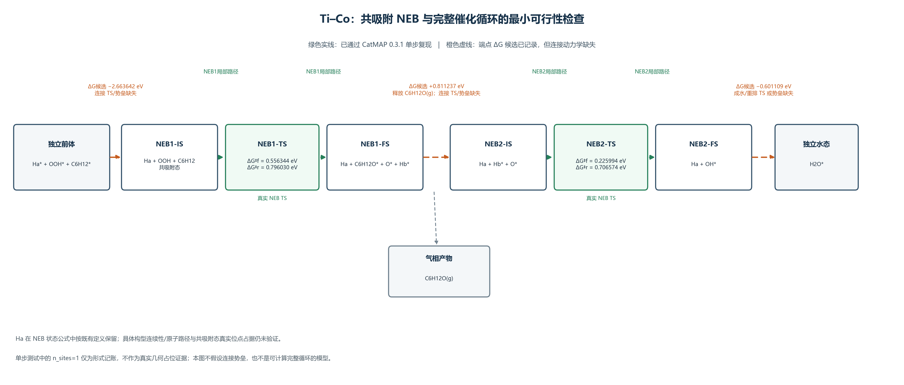

# Ti–Co 共吸附 NEB 与完整催化循环：最小可行性检查

## 结论

**当前资料不足以建立具有完整动力学定义的 CatMAP 催化循环，因此尚不具备可信的完整循环 TOF 计算条件。** 两条共吸附 NEB 的局部反应路径已由 CatMAP 0.3.1 原生接口复现；但这只给出各自 IS↔FS 的正、逆速率常数，不能为 NEB 状态与原八步独立吸附态之间的三个连接提供速率。

若暂按已有端点定义接受连接反应自由能候选值，三个连接分别缺少可追溯的连接过渡态或至少一个绝对活化自由能。端点 ΔG 只能约束正、逆势垒之差，不能确定二者的绝对值。另需明确这些端点是否确为所列同一微观状态，以及对应 CatMAP 位点占据定义；现有单步测试的 \`n_sites=1\` 明确只是形式记账，不能作为真实几何占位证据。

## 证据范围与状态标签

- **CONFIRMED（局部 NEB 数值复现）**：复用 \`tico_neb_single_step_native_replay/results/native_replay_results.json\`。CatMAP 版本为 0.3.1；NEB1、NEB2 均解析出单一步骤及显式 TS；总元素组成/形式位点检查、自由能差、正逆势垒和详细平衡比值检查均为 PASS。没有求解稳态、覆盖度、TOF 或 DRC。
- **PROVISIONAL（跨态端点 ΔG）**：三个连接的候选 ΔG 来自既有 \`NEB_CONNECTION_ENERGY_MAP.csv\`。它们是已整理端点能量的差值，不等于连接势垒，也不自动证明端点结构同一。
- **UNVERIFIED（微观结构与位点映射）**：状态名称/物种组成层面可对照；精确吸附构型等价、Ha 的原子级路径、真实有效位点数及共吸附态的 CatMAP 占位方式，在本轮复用材料中没有充分证据。
- **KINETIC_DATA_MISSING**：连接反应没有独立 TS 或可追溯的绝对活化自由能；本报告不为缺项赋值。

研究者已确认所用 Gibbs 能量均已热修正。本轮不重复检查温度、振动频率或热修正。

## 已复现的局部 NEB 步骤

| 路径 | 状态总组成 | ΔG (eV) | 正向势垒 (eV) | 逆向势垒 (eV) | CatMAP 官方速率常数（s⁻¹） |
|---|---|---:|---:|---:|---|
| NEB1 IS → TS → FS | C₆H₁₄O₂ | −0.239686 | 0.556344 | 0.796030 | 正向 2.6624798×10⁴；逆向 6.300847 |
| NEB2 IS → TS → FS | H₂O | −0.480580 | 0.225994 | 0.706574 | 正向 2.6467171×10⁹；逆向 1.4212109×10² |

正逆势垒分别由该 NEB 路径自身 IS、TS、FS 的 Gibbs 能量得到。详细平衡比值与 \`exp(−ΔG/kBT)\` 的相对差分别约 \`1.93×10⁻¹⁵\` 和 \`9.67×10⁻¹⁶\`。这里的 PASS 只限局部 NEB 单步复现；它不是完整循环验证。

## 三条必要连接的逐项判断

### 1. 独立前体 → NEB1-IS

- 端点定义：独立吸附态 \`Ha* + OOH* + C6H12*\` → 完整共吸附 NEB1-IS（所列 NEB 状态包含 Ha 旁观物）。
- 已有候选 \`ΔG = −2.663642 eV\`，状态能量差来自既有能量映射表，标记 **PROVISIONAL_ENDPOINT_DELTA_G**。
- 元素总组成在账面上可闭合；Ha 被列入前体及 NEB1 状态。**Ha 是否保持同一空间构型、OH/OOH 相关片段是否发生重排、两端是否同一超胞/有效位点状态：UNVERIFIED。**
- **KINETIC_DATA_MISSING**：无此缔合/重排连接的独立 TS 或绝对活化自由能。若端点映射成立，至少需要一个方向的连接活化自由能；反向势垒可再由 ΔG 与详细平衡确定。
- 实际占位数不从片段数推断；共吸附态真实位点占据仍未验证。

### 2. NEB1-FS → NEB2-IS + C₆H₁₂O(g)

- 端点定义：NEB1-FS（状态组成包含 Ha、吸附环氧产物、O、Hb）→ NEB2-IS（包含 Ha、Hb、O）并释放气相 C₆H₁₂O。
- 已有候选 \`ΔG = +0.811237 eV\`，标记 **PROVISIONAL_ENDPOINT_DELTA_G**。
- 总原子组成可按所列气相产物闭合；Ha 在两端均列为旁观片段。**Ha 是否是同一微观构型、环氧物种脱附与表面重组是否对应该单一端点连接、O/Hb 构型如何重排：UNVERIFIED。**
- **KINETIC_DATA_MISSING**：缺少产物释放/重排连接的独立 TS 或绝对活化自由能。NEB1 的 TS 仅描述 NEB1-IS→NEB1-FS，不可直接当作本连接的 TS。
- 位点占据及连接中间态的定义未由真实几何证据确定。

### 3. NEB2-FS → H₂O*

- 端点定义：NEB2-FS（所列组成为 Ha+OH）→ 独立 H₂O*。
- 已有候选 \`ΔG = −0.601109 eV\`，标记 **PROVISIONAL_ENDPOINT_DELTA_G**。
- 元素组成可按 Ha 提供一个 H、OH 提供 H/O 与 H₂O* 对照；但 **Ha 的原子身份是否实际转移到水、OH/水吸附构型是否同一状态、该连接是否还包含位点重排：UNVERIFIED。**
- **KINETIC_DATA_MISSING**：无成水/重排连接的独立 TS 或绝对活化自由能。NEB2 TS 只支持 NEB2-IS↔NEB2-FS，不等于 NEB2-FS→H₂O* 的连接 TS。
- 真实位点占据和状态映射仍需明确，不能用化学片段数量代替 \`n_sites\`。

详见 [TICO_CONNECTION_DATA_STATUS.csv](TICO_CONNECTION_DATA_STATUS.csv)。

## 最小可行的后续数据需求

在不增添未经支持的状态或势垒前，至少需要针对上述三条连接分别获得：

1. **状态映射确认**：端点是否为同一超胞、同一活性位及可比较的微观状态；列出 Ha 在各端的具体归属/去向和原子映射；明确真实有效位点占据，不以片段计数代替。
2. **连接动力学参数**：每条连接一个独立、可追溯的 TS Gibbs 能量，或等价的单向绝对活化自由能。若现有端点 ΔG 经状态映射确认可用，另一方向势垒由详细平衡导出。
3. **反应表示核对**：将状态计量、气相产物及位点变化写入 CatMAP 表达式后，用官方解析及化学/位点守恒验证；这一步不能补出缺失动力学参数。

因此，真正阻止完整循环动力学计算的首要缺项不是 NEB1/NEB2 局部势垒，而是三条跨态连接各自的动力学势垒；此外其状态同一性与有效位点映射尚未确认。现有资料只足以计算两个独立 NEB 单步，不能唯一确定完整循环的稳态覆盖度或 TOF。**本轮未运行完整稳态、TOF、DRC，也未新增 CatMAP 反应网络。**

## 反应网络图

实线框/箭头表示已由原生 CatMAP 单步复现的 NEB 路径；虚线连接表示端点 ΔG 候选已记录、但连接动力学缺失。图中不代表真实位点占据数，也不宣称完整机理已验证。

## 复用文件

- 单步复现输入、脚本和运行结果：\`analyses/explicit_OOH_8step_validation/tico_neb_single_step_native_replay/\`
- 连接状态/缺项清单：\`tico_neb_single_step_native_replay/NEB_CONNECTIONS_AND_GAPS.md\` 与 \`NEB_CONNECTION_REQUIREMENTS.csv\`
- 候选端点自由能差：\`analyses/explicit_OOH_8step_validation/full_8step_physical_model/data/NEB_CONNECTION_ENERGY_MAP.csv\`
- NEB 绝对 Gibbs、Excel 单元格/公式缓存值与参考态对照：\`analyses/explicit_OOH_8step_validation/neb_coadsorption_gibbs_mapping/TICO_NEB1_NEB2_GIBBS_REFERENCE.csv\`、\`TICO_REFERENCE_DIFFERENCE.md\`
- 原始八步模型及独立态能量来源：\`lyq_alkene_epoxidation/2-creating_microkinetic_model/alkene_epoxidation.mkm\`、\`energies_dft_neb.txt\`
- 原始 NEB 汇总对照：\`lyq_alkene_epoxidation/2-creating_microkinetic_model/DFT_TS_relative.csv\`（Ti–Co 行）

单步复现记录中的正式来源 SHA256：

- 原始八步模型：\`86115cefb7784fe28ab519271cdfaf0e308b6f6e3a8308b1e90e4318cb497cfe\`
- 原始 NEB/独立态能量文件：\`55ad4e94d9c603b6705ec8c92630c9a1ceff5859cf69865145152375e203ca30\`
- NEB 相对能 CSV：\`a967325ec1fd17207a7d51857cda01a23d8f76a846200b74f229e64d30e1cdfd\`
- Excel 工作簿：\`90f1700457ece5a53335ef771e88e24134c00afab57b3d8ec15a18bb307f38bd\`
- 原始八步网络：\`lyq_alkene_epoxidation/2-creating_microkinetic_model/alkene_epoxidation.mkm\`

原始文件、正式模型及历史计算结果均未修改。本目录结果是独立可行性检查，不是完整动力学模型。
